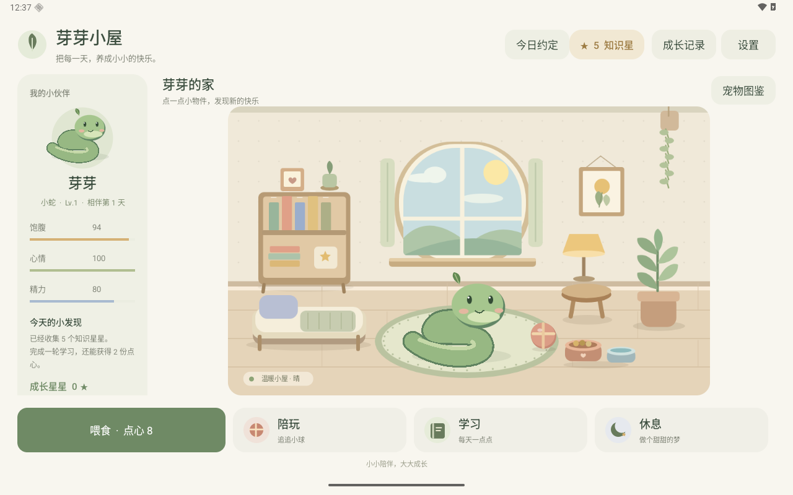

# 芽芽小屋

面向安卓平板的一年级学习电子宠物。第一位伙伴是 2D 小蛇「芽芽」，从一枚蛋开始，在自己的小屋里长大。



## 当前版本

- **孵化**：默认数学、拼音、汉字、英语各一道题，也可按家长方案分配；每答对一题加温 25%，中途退出保留进度。
- **喂食**：浆果点心、小虫饼干和清凉水；饱腹、心情、精力各自变化。
- **陪玩**：在小屋追到三次闪闪的小球，再按学习方案答一道题，获得心情和亲密度。
- **休息与抚摸**：点小床睡觉或叫醒，休息恢复精力；点小蛇能抚摸，出现爱心。
- **可互动家具**：绘本书架、软软小床、点心碗、小球和窗边绿植。
- **四类学习**：加减法、拼音、识字和英文词汇；语数英各有三档难度。综合练习可选 5 / 10 / 20 题，单科练习三题，每题一颗知识星星，每轮奖励两份点心。
- **成长记录**：按学科统计星星，记录学习轮数、相伴天数、亲密度和等级。
- **本机存档**：孵化、名字、养成数值、星星、点心、睡眠和朗读开关重启后保留。
- **生活约定**：沿用 star-collect 的每日任务，孩子提交、家长确认，每项每天一次；可自定义、修改奖励、停用、退回或撤销。
- **成长星星与礼物**：家长确认生活任务获得成长星星，可兑换点心礼包与伙伴庆祝派对。知识星星保留学习成绩，成长账本记录任务、娱乐用量、礼物和补奖扣星。
- **娱乐 App 约定**：家长选择已安装 App，设置每日免费分钟、计费分钟和扣星数量；按实际前台时长结算，后台约 15 分钟尝试同步，重复刷新不重复扣星。
- **家长设置**：4–8 位数字 PIN，保护奖励、学习方案、App 约定、更新与重新领养；离开应用、退出家长页面或 5 分钟后锁定。
- **手动升级**：设置内检查版本、查看说明、下载、校验，并由家长和安卓系统确认覆盖安装。与 star-collect 共用 139 的 Release 下载服务。

答错可以重试，不扣分。小蛇不会死亡。没有广告、内购或账号。只有家长主动检查或下载更新时才联网。中文和英文朗读调用系统 TTS，设备需要已有相应语音数据；没有声音时仍能完成所有玩法。

## 构建和安装

原生 Java + Android Canvas，运行时无需第三方库。Android 8.0（API 26）以上，编译与目标版本 API 36。界面优先横屏平板，支持屏幕尺寸变化；Android 16 大屏设备可以自由旋转。

需要 Android SDK 36、JDK 17 或以上。Windows 可直接使用 Android Studio 自带的 JBR：

```powershell
.\tools\build.ps1
# 构建、测试、lint，并安装到已连接的平板或模拟器
.\tools\build.ps1 -Install -Serial emulator-5556
```

安装包输出：`artifacts/ai-pet-v0.2.0.apk`，固定签名的正式安装包。首次构建需要配置已有的签名密钥；[更新与签名说明](docs/manual-updates.md)介绍配置和发布方法。可用 `-Debug` 构建调试包。

旧版 0.1.0 需先覆盖安装一次新版，保留存档；0.1.1 可在「设置 → 检查应用更新」下载升级。[下载 0.2.0](https://home.sunny-string.cn/github-release/string1225/ai-pet/download/v0.2.0/ai-pet.apk)。首次进入新版家长空间需设置 PIN。

## 生活约定怎么结合养宠物

主页的「今日约定」记录阅读、作业、运动、整理、作息和帮助家人。孩子提交后，家长在「设置 → 家长空间」确认；提交时的任务名称与奖励会保留，即使家长后来修改任务。每项每天一次，撤销奖励会留下对应账本记录。

知识星星属于当前宠物的学习记录；成长星星属于整个家庭账本，所有宠物共享。3 颗成长星星可换 2 份点心；5 颗可举办伙伴庆祝派对，亲密度 +12、心情 +10。礼物绑定购买时的宠物，持久保存送达编号，重启不会重复发放。

娱乐用量只扣成长星星，可以暂时欠星；学习、知识成绩和基础照顾继续进行。家长开启系统「使用情况访问权限」后，统计选定 App 的前台时长。首次授权不追扣之前的用量；修改或停用前先结算，保留历史记录。提供记录和结算，与家庭约定配合使用，没有强制关闭其他 App 的功能。

家长可按原因补奖或扣星，按日期查看记录，并通过系统文件选择器导出 JSON 留档（不含 PIN 凭据）。重新领养只重置当前宠物，生活任务、成长账本、PIN 和学习方案保留。

## 学习难度和比例

入口：**设置 → 语数英学习方案**，或家长空间内同名入口。

| 学科 | 启蒙 | 基础（默认） | 挑战 |
|---|---|---|---|
| 语文 | 单韵母拼读、8 个常用字 | 拼音拼读、辨认字形 | 四声辨读、词语补字 |
| 数学 | 5 以内加减 | 10 以内加减 | 20 以内加减 |
| 英语 | 8 个常见词 | 动物、颜色和日常词汇 | 看英文选中文意思 |

默认语文 40%、数学 40%、英语 20%；语文中拼音和识字各占一半。提供均衡、语文重点、数学重点、英语重点预设，也可直接填写百分比；语数英合计必须为 100%，0% 会停用对应题目和单科入口。语文内部拼音比例可以单独设置。

10 题默认综合回合为 2 题拼音、2 题识字、4 题数学、2 题英语。不能整除时按比例随机取整，小比例科目会在多轮中出现；短活动按比例抽题。词库少于回合题数时会轮换复习。

方案影响综合练习、单科难度、孵化、赚点心和陪玩后的题目，已开始的回合保留当轮题目，下一轮采用新方案。默认孵化保持四种题各一道，自定义孵化按配置分配四题。

其他平台可配置 `JAVA_HOME` 和 `local.properties`，再执行：

```sh
./gradlew assembleDebug testDebugUnitTest lintDebug
adb install -r app/build/outputs/apk/debug/app-debug.apk
```

## 扩展框架

宠物配置、养成逻辑、学习内容、绘制和存档独立。新增宠物无需改动题库或小屋互动规则，图鉴会自动列出已注册宠物，每种宠物有独立存档。

| 模块 | 职责 |
|---|---|
| `model/PetDefinition`、`PetRegistry` | 宠物种类、默认名字、描述、喂食和陪玩数值 |
| `model/PetState`、`PetEngine` | 孵化、养成、休息、亲密度、成长奖励 |
| `model/PetStore` | 带版本号的 JSON 本机存档和宠物切换 |
| `learning/Subject`、`QuestionBank` | 四学科题目、干扰项、提示和朗读内容 |
| `ui/PetRenderer`、`RendererRegistry` | 注册不同宠物的 2D 绘制器 |
| `ui/RoomView` | 小屋场景、触摸、家具、追球及无障碍按钮 |
| `MainActivity` | 平板布局、互动弹窗和学习回合 |
| `family/FamilyState`、`FamilyStore` | 家庭任务、审批、账本、用量规则、礼物队列与学习方案的原子保存 |
| `family/UsageTimeline`、`UsageTracker` | Android 前台事件、按日免费额度与完整计费单位结算 |
| `FamilyController` | 家长 PIN、今日约定、礼物、学习选项和娱乐 App 约定 |
| `learning/LearningSettings` | 三档难度、语数英与语文子比例、回合配额 |

详细说明见 [扩展指南](docs/architecture.md)。

## 验证

```powershell
.\tools\build.ps1
python tools\tablet_smoke.py --serial emulator-5556
# 在同一台 Android 16 测试模拟器上验证旋转、改名、家长重置
python tools\tablet_regression.py --serial emulator-5556
```

UI 冒烟脚本会清空**所选模拟器中本应用**的数据，实际操作所有孵化与学习题、喂食、追球、休息和重启，并生成截图及 `artifacts/smoke-results.json`。勿对有真实存档的设备运行此脚本。

家庭与课程集成测试使用可丢弃的 API 29+ 模拟器，要求已孵化的伙伴。先构建并安装 debug 和 androidTest APK：

```powershell
.\gradlew.bat assembleDebug assembleDebugAndroidTest
adb -s emulator-5556 shell am instrument -w com.string.aipet.test/com.string.aipet.FamilyInstrumentation
adb -s emulator-5556 shell am instrument -w -e suite usage com.string.aipet.test/com.string.aipet.FamilyInstrumentation
```

第一套重置家庭测试记录并验证审批、礼物、PIN 和课程配置；第二套在系统设置 App 中实际停留约 64 秒，检查用量、扣星和停用。只在测试模拟器运行。

手动更新的本地 fixture、APK 校验、系统安装与公网服务验证见 [手动更新回归](docs/manual-updates.md)。

验证记录见 [测试记录](docs/verification.md)。
